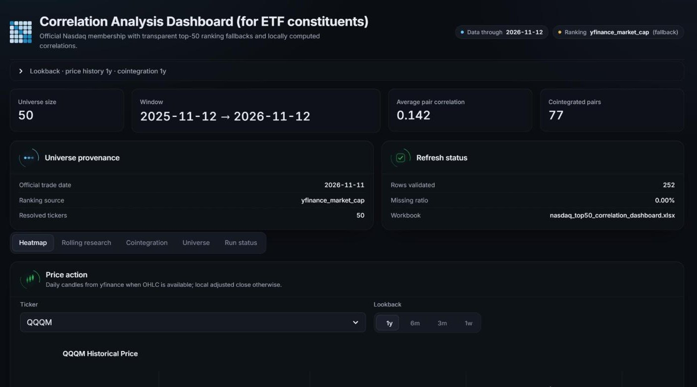
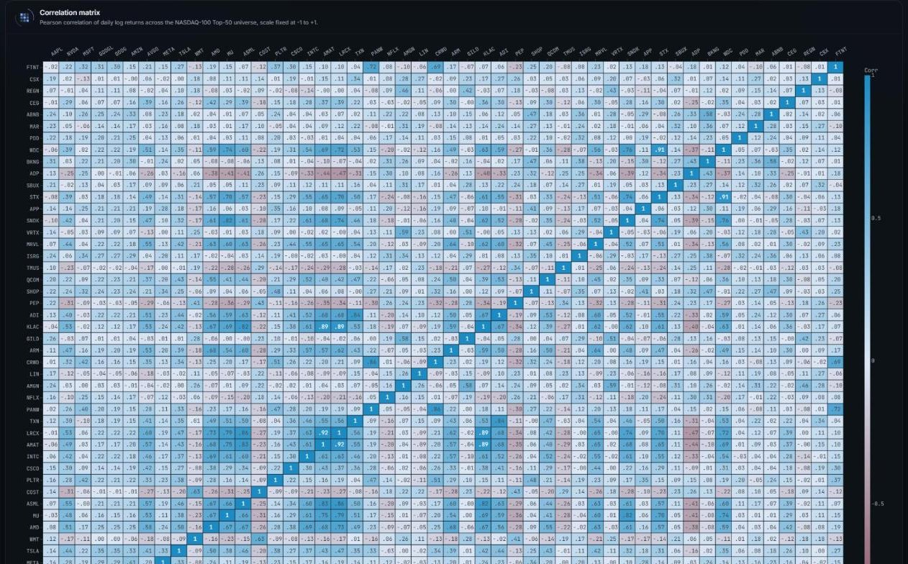
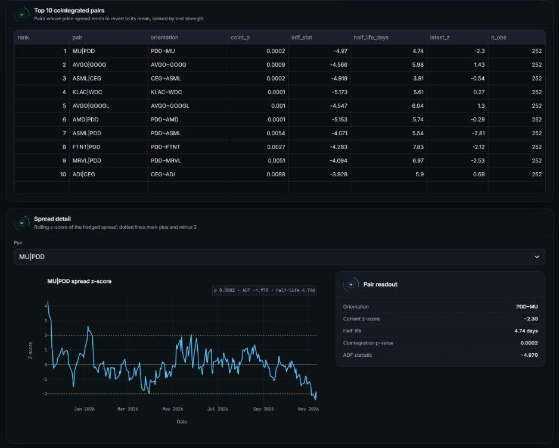

# Correlation Analysis Dashboard (for ETF constituents)

Research dashboard for the correlation structure of an **ETF's constituents**: out of the box the
**top 50 NASDAQ-100 stocks** (the QQQ/QQQM basket), or the top holdings of **any ETF** from its
issuer's holdings export. It pulls daily prices, computes returns and the full correlation matrix
locally, tests every pair for Engle-Granger cointegration, and shows it all in a Streamlit app plus
two Excel workbooks. Every artifact records where its data came from.



> **Not investment advice.** This is a research and learning tool. Correlations and cointegration
> tests describe the past and can break down without warning. Nothing here is a recommendation to
> buy or sell anything. See the [License](LICENSE): the software is provided as-is, without warranty.

## What it does

- **Universe:** the official NASDAQ-100 membership from Nasdaq's public index data, ranked by QQQM
  holdings weight, falling back to Yahoo Finance market cap. Members that started trading after the
  lookback began (recent IPOs) are swapped for the next-ranked name, and the swap is shown.
- **Correlation:** log returns and an N×N Pearson matrix, a rolling average correlation for the
  universe, single-pair rolling correlation, and the biggest changes since the previous run.
- **Cointegration:** Engle-Granger plus residual ADF on every pair (1,225 for 50 names), with hedge
  ratio, half-life and spread z-score. Pairs where either stock is range-bound rather than trending
  are tested but not qualified, because the test is not valid for them.
- **ETF mode:** the same analysis on the top 50 holdings by fund weight of any ETF (e.g. `TAN`), from the issuer's holdings export. Funds with fewer holdings use them all; `--top-n` changes the count.
- **Outputs:** CSV/JSON artifacts in `data/processed/` and Excel workbooks in `exports/`.
- **Interface:** a dark, token-based theme (Inter and JetBrains Mono) with one panel per question,
  hover tooltips and crosshairs on every chart, and small animated panel emblems. The correlation
  matrix adapts to the screen: wider on large monitors, with cell labels sized to fit. Animations
  switch off when the system asks for reduced motion.




## Quickstart

Requires Python 3.11 or newer.

```bash
git clone https://github.com/ArcadiaL00ts/Correlation_Analysis_Dashboard.git && cd Correlation_Analysis_Dashboard
python -m venv .venv
# Windows: .venv\Scripts\activate      macOS/Linux: source .venv/bin/activate
pip install -e .

corrdash-update --history-period 2y   # resolve universe, fetch prices, compute everything (~1–2 min)
corrdash-app                          # open the dashboard at http://localhost:8505
```

`corrdash-update` without `--history-period` asks for the price-history and cointegration lookbacks.
On Windows without a virtual environment, use `py -3` in place of `python` (a bare `python` may be
the Microsoft Store placeholder).

**Without installing**, the scripts work from the repo folder: `python scripts/update_dashboard.py`,
`python scripts/run_dashboard.py`. Wrappers: `commands/update-dashboard.ps1|.sh`,
`commands/open-dashboard.ps1|.sh`, `commands/run-etf.ps1|.sh`.

| Command | What it does |
|---|---|
| `corrdash-update [--history-period 2y] [--pairs-history-period 1y]` | Full NASDAQ-100 refresh |
| `corrdash-etf --etf TAN [--holdings file.csv] [--top-n 50\|100\|all]` | Same pipeline on an ETF's top holdings by weight |
| `corrdash-pairs [--history-period 1y]` | Re-run cointegration only, on already-downloaded prices |
| `corrdash-universe` | Preview the resolved top-50 universe (writes nothing) |
| `corrdash-app [--config data/etf/TAN/config.json] [--port 8505] [--lan]` | Launch the dashboard (this computer only; `--lan` lets other devices on the network connect) |
| `python -m unittest discover tests` | Run the offline test suite |

## Running on an ETF's holdings

1. On the issuer's fund page, download the holdings file (Invesco: *Holdings → Export data*;
   iShares: *Holdings → Detailed Holdings and Analytics → Download*; SPDR: *Holdings → Download
   Daily Holdings*; Global X / Vanguard: *Holdings → Export/Download*).
2. Save it as `data/manual_universe/<ETF>_holdings.csv` (or `.xlsx`), or pass `--holdings <path>`.
3. Run `corrdash-etf --etf <ETF>`, then `corrdash-app --config data/etf/<ETF>/config.json`.

The run correlates the **top 50 holdings by fund weight** (`etf_runs.default_top_n` in the config).
Pass `--top-n 100` (or `all`) for more, or answer the prompt. A fund with fewer holdings is used in
full (TAN's 35 holdings give a 35×35 matrix). If Yahoo cannot price a holding, the next-heaviest
one takes its place, and the metadata lists the share of fund weight covered.

The parser finds the header row under any title/preamble, skips cash, money-market, futures and
other non-equity lines, and maps each holding to its Yahoo Finance symbol using the exchange
column, ISIN or CUSIP. When a listing is ambiguous (for example Taiwan's two exchanges `.TW` and
`.TWO`), it checks Yahoo once and remembers the answer in `data/manual_universe/symbol_map.json`.
Holdings the export leaves without a ticker (often ADRs) are listed as "Not included" with their
identifier; add them with `--ticker-map 23703Q203=DQ` (identifier or local ticker `=` Yahoo symbol).
ETF outputs go to `data/etf/<ETF>/` and `exports/etf/<ETF>/`; the NASDAQ-100 files are untouched.

## Choosing lookbacks

The dashboard's **Lookback** panel (under the title) re-runs the pipeline in the background for
new windows; reloading the page or opening it elsewhere shows the same job, and a second run can't
start while one is active. Price history: `1w`, `1m`, `3m`, `6m`, `1y`, `2y` … `max`.
Cointegration: `1m` and up.

- **1w** gives about 4 daily returns per pair. The numbers are mostly noise; use it to see the
  last few days, not to draw conclusions.
- **Cointegration needs at least 20 overlapping days**, so the shortest window is `1m`, and even
  that is fragile. `1y` or longer is the meaningful range.

## Configuration

Everything lives in [`config/dashboard_config.json`](config/dashboard_config.json): universe
size and ranking sources, history and validation limits, cointegration thresholds
(`pairs_trading`), file paths and theme colours.

- `dashboard.enable_rerun` (default `true`): set it to `false` for any **shared or hosted
  deployment**, otherwise any visitor can start long data downloads. The tool is meant to run locally.
- The dashboard listens on `127.0.0.1` only by default. `corrdash-app --lan` (or the
  `DASHBOARD_ADDRESS` environment variable) serves it on the network instead; anyone who can reach
  the port can then use the re-run button, so pair it with `dashboard.enable_rerun: false`.
- `price_source.fallback_provider: "csv_directory"`: if Yahoo Finance is unavailable, put one CSV
  per ticker (`Date` plus `Adj Close` or `Close`) in `data/manual_prices/`.

No API keys or accounts are needed.

## Troubleshooting

| Symptom | Fix |
|---|---|
| `CERTIFICATE_VERIFY_FAILED` | A company proxy or antivirus is inspecting HTTPS. On Windows this is handled automatically (a CA bundle is built from the Windows certificate store; look for the `[tls]` line). Elsewhere, export your organisation's root certificate as PEM and set `DASHBOARD_CA_BUNDLE=/path/to/root.pem`. For `pip install`, set `PIP_CERT` to the same file (on Windows: `%LOCALAPPDATA%\nasdaq-correlation-dashboard\ca_bundle.pem` after one run). |
| `yfinance returned an empty dataset` or blank tickers | Yahoo Finance is unofficial and changes without notice. Blank symbols are retried once automatically. Upgrade with `pip install -U yfinance`, or use the CSV fallback above. |
| `X (rank N) first traded …, replaced by Y` | Not an error: a recent listing was swapped for the next-ranked name so the full window can be used. Choose a shorter lookback to keep it. |
| `Maximum missing ratio … exceeds allowed` | A ticker has gaps beyond `validation.maximum_missing_ratio` (5%). Check the symbol or use a shorter lookback. |
| `Port 8505 is in use by another program` | `corrdash-app --port 8510` |
| Universe tab flags "zero-return days" | Thin trading or local holidays (common for Tel Aviv / Hong Kong listings in ETF runs). Their correlations with other names read low. |

## Data sources and terms

- **Nasdaq** public index weighting data (membership) and **Invesco QQQM** public holdings (ranking).
- **Yahoo Finance** via the unofficial [`yfinance`](https://github.com/ranaroussi/yfinance)
  package for prices and the market-cap fallback. Yahoo's data is for personal, non-commercial use;
  check its terms before using it for anything else.
- ETF holdings files come from the issuers' public pages and are not included in this repository.

## Development

See [CONTRIBUTING.md](CONTRIBUTING.md). `codex.md` is the change log and troubleshooting history;
`CLAUDE.md` and `.claude/skills/` hold instructions for Claude Code users.

## License

[MIT](LICENSE).
